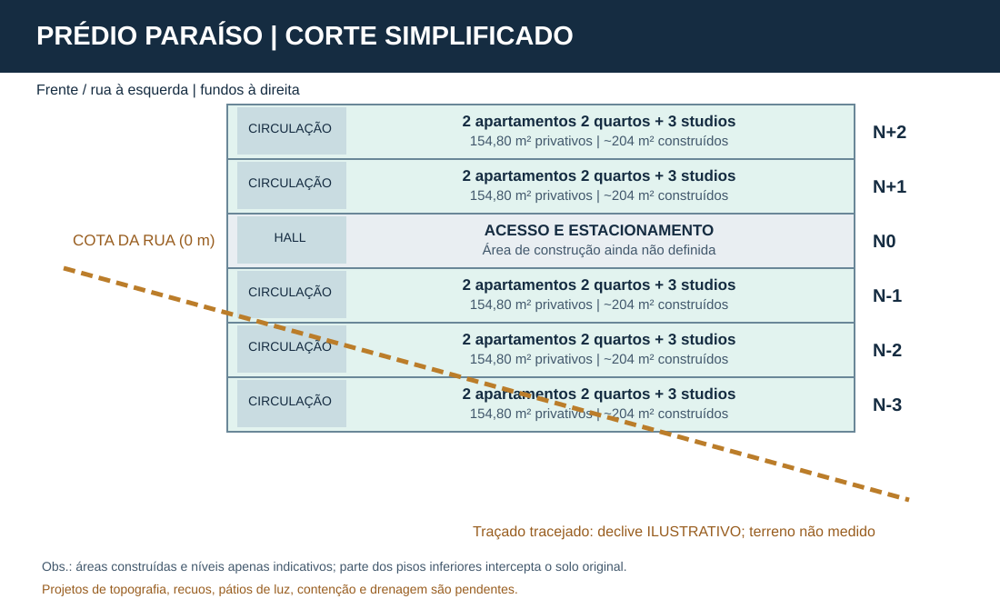

# Corte simples e áreas por andar

> **ESTUDO CONCEITUAL, NÃO PROJETO LEGAL OU EXECUTIVO.**

O corte considera **2 pavimentos residenciais acima da rua**, **1 nível de acesso/estacionamento na cota da rua** e **3 pavimentos residenciais abaixo da rua**.

## Quadro de áreas (estimativas)

| Pavimento | Cota relativa suposta | 2 aptos 2 quartos (39,99 m² cada) | 3 studios (24,94 m² cada) | Área privativa modular | Área construída bruta |
|---|---:|---:|---:|---:|---:|
| N+2 | +6,00 m | 79,98 m² | 74,82 m² | **154,80 m²** | **~204 m²** |
| N+1 | +3,00 m | 79,98 m² | 74,82 m² | **154,80 m²** | **~204 m²** |
| N0 | 0,00 m | — | — | **a definir** | **a definir** |
| N-1 | -3,00 m | 79,98 m² | 74,82 m² | **154,80 m²** | **~204 m²** |
| N-2 | -6,00 m | 79,98 m² | 74,82 m² | **154,80 m²** | **~204 m²** |
| N-3 | -9,00 m | 79,98 m² | 74,82 m² | **154,80 m²** | **~204 m²** |
| **Total residencial** | | **399,90 m²** | **374,10 m²** | **774,00 m²** | **~1.020 m²** |

**~49,2 m² por pavimento residencial** são atribuídos à diferença estimada entre área construída e os módulos privativos: circulação, paredes, escada, elevador e áreas comuns. **Os 39,99 m² e 24,94 m² não equivalem a áreas úteis líquidas verificadas** (ainda não foram descontadas as espessuras efetivas das paredes e elementos técnicos).

N0 destina-se a acessos, possíveis vagas frontais e infraestrutura, com área construída **a definir em projeto**. Assim, o **total global de construção é superior aos ~1.020 m²** e não pode ser calculado com precisão nesta etapa.

## Avisos de viabilidade

- Cotas verticais de 3,00 m/pavimento são **hipóteses esquemáticas**, não dimensões aprovadas.
- O desnível de até 13 m foi obtido de modelo Mapzen de baixa resolução, **sem confirmação por levantamento planialtimétrico**.
- Repetir o mesmo piso de 204 m² abaixo da rua implicaria parte da construção enterrada; não demonstra aproveitamento otimizado do declive e não dispensa **cortes, contenções, drenagem e fachadas/pátios de iluminação**.
- O estudo não confirma que recuos, coeficiente, taxa de ocupação, gabarito, exigências de vagas e faixa sanitária permitam cinco pavimentos residenciais ou 25 unidades.
- Levantamento topográfico, sondagem, consulta urbanística oficial e projeto de profissional habilitado são indispensáveis antes de construir.

[Voltar ao estudo de viabilidade](viabilidade.md).
